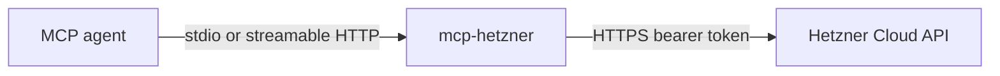

# Hetzner Cloud MCP

Repository: github.com/foxcore-cloud/hetzner-mcp (product name: Hetzner Cloud MCP). An MCP server that manages one Hetzner Cloud project: it holds the project token and calls the Hetzner Cloud API on behalf of the agents connected to it.

## Status

Live. Releases are cut from version tags and published as archives with checksums; the latest release is v0.3.0. Observed 2026-11-09.

## Why it exists

A project runs Hetzner Cloud resources and wants its agents to act through one MCP server instead of passing API tokens into every tool. The server resolves the project token once at startup and attaches it to every Hetzner Cloud request. Agents never see a token, a hostname, or an Authorization header.

## Quickstart

Build and run with stdio transport, the default for local agents:

```bash
go build -o mcp-hetzner ./cmd/mcp-hetzner
```

`./mcp-hetzner --version` prints the build version ("dev" for a local build) and exits 0.

Run the server. The project token comes from HCLOUD_TOKEN in the environment, or from the active context in ~/.config/hcloud/cli.toml (context name from HCLOUD_CONTEXT). Never paste a real token into a command you share.

```bash
HCLOUD_TOKEN=... ./mcp-hetzner
```

The server stays attached to stdio. Close stdin to stop it.

For streamable HTTP:

```bash
./mcp-hetzner --transport http --host 127.0.0.1 --port 8080
```

It listens on loopback only. A listener on any other host is refused unless MCP_AUTH_TOKEN is set, because the endpoint holds the project token; the process then exits non-zero (cmd/mcp-hetzner/guard.go).

Check any change:

```bash
go build ./...
go vet ./...
go test ./...
```

Each exits 0 when the tree is clean. This is the repository gate; there is no separate gate script.

## Architecture

One agent speaks MCP to mcp-hetzner, which turns each tool call into a Hetzner Cloud API call and returns the result:



The binary resolves the project token at startup (internal/auth/token.go), builds one authenticated hcloud client, and registers every MCP tool against it (internal/server/app.go). State-changing tools wait for the run to finish unless wait is false, and paged results continue with next_page. Where no dedicated tool exists, find_operations returns a Cloud API path and cloud_get or cloud_api performs the request (internal/server/register.go).

## API and configuration summary

Configuration is environment only: HCLOUD_TOKEN, HCLOUD_CONTEXT, HCLOUD_CONFIG, MCP_HOST, MCP_PORT, MCP_AUTH_TOKEN. Flags: -transport (stdio or http, default stdio), -host (default 127.0.0.1), -port (default 8080), -version (print and exit).

The server calls the Hetzner Cloud API (https://api.hetzner.cloud/v1) through hcloud-go and speaks MCP through modelcontextprotocol/go-sdk. Tool groups: project overview (describe_project), servers, actions, server types, images, locations, SSH keys, volumes, firewalls, private networks, load balancers, primary IPs, and floating IPs. The full tool set is registered in internal/server/register.go; endpoint lists are not copied here — read them from the code.

## Security and operations

Exposure boundary: the HTTP listener binds to loopback by default, and a non-loopback host is refused unless MCP_AUTH_TOKEN requires a bearer token on every request (cmd/mcp-hetzner/guard.go). The project token never travels to or from an agent: tools never accept a token, and the server attaches it to each request itself (internal/auth/token.go). Logs go to stderr. The release version is stamped by the linker at build time (internal/server/version.go).

## Further documentation

- CONTRIBUTING.md — how to run, check, and contribute to this repository
- hcloud-go — https://github.com/hetznercloud/hcloud-go — Hetzner Cloud API client
- modelcontextprotocol/go-sdk — https://github.com/modelcontextprotocol/go-sdk — MCP protocol SDK
- Releases — https://github.com/foxcore-cloud/hetzner-mcp/releases — version-tagged archives and checksums
